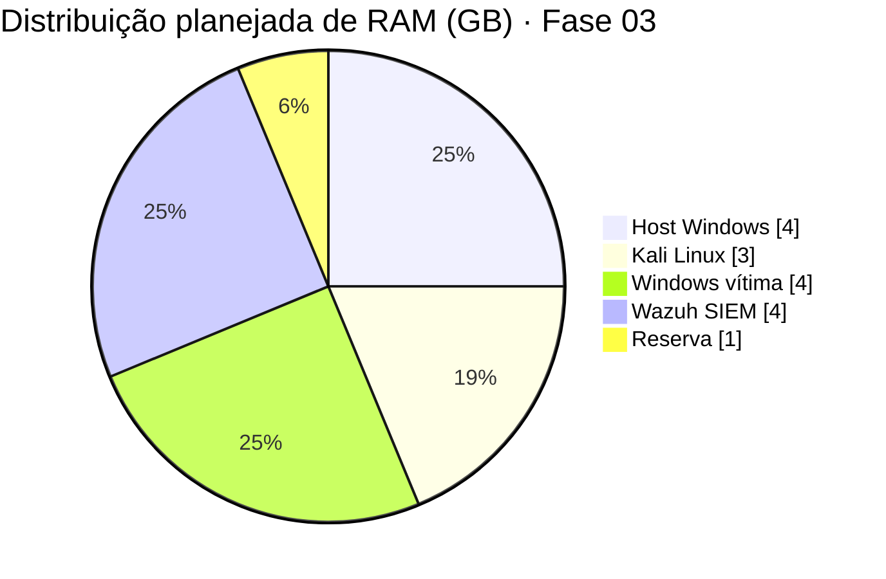

<div align="center">

<a href="../README.md">🏠 Início</a> · <b>🧪 00 · Laboratório</b> · <a href="../01-recon/">📡 01 · Reconhecimento ➜</a>

# 🧪 Fase 00 · Montagem do Laboratório

**Um ambiente isolado, reproduzível e documentado para emular ataques e validar detecções com segurança.**


</div>

---

## 📋 Resumo executivo

| | |
|:---|:---|
| **Objetivo** | Criar a base do laboratório: hypervisor, rede isolada e máquina atacante |
| **Resultado** | Kali Linux operacional na rede `LabNet` (`10.10.10.0/24`), sem acesso à rede doméstica |
| **Princípios aplicados** | Isolamento · Segmentação · Integridade · Menor privilégio · Recuperabilidade |
| **Destaque técnico** | Identificação de que a Rede NAT do VirtualBox **recria** pacotes ICMP ([ver achado](#achado-ttl)) |

---

## 💻 Ambiente host

| Componente | Especificação | Impacto no laboratório |
|:---|:---|:---|
| CPU | AMD Ryzen 7 5700X · 8C/16T | Suporta várias VMs simultâneas com folga |
| Memória | 16 GB DDR4 3200 MHz | **Principal limitação** · orçamento de RAM abaixo |
| GPU | NVIDIA RTX 3060 | Reservada para auditoria de senhas (Hashcat) nas fases avançadas |
| Armazenamento | 1 TB | VMs com discos dinâmicos |
| Virtualização | AMD-V (SVM) habilitado na BIOS | Pré-requisito para VMs 64-bit com bom desempenho |

### 🧮 Orçamento de memória



> Nas fases 00–02 apenas Kali e um alvo rodam ao mesmo tempo. Na fase 05 (Active Directory) as VMs
> serão revezadas ou a memória será expandida para 32 GB.

---

## 🏛️ Decisões de arquitetura

Cada escolha do laboratório foi registrada com alternativas e justificativa, no formato de
*Architecture Decision Records* (ADR).

<details open>
<summary><b>ADR-001 · Hypervisor: Oracle VirtualBox</b></summary>

| | |
|:---|:---|
| **Decisão** | VirtualBox como hypervisor do laboratório |
| **Alternativas** | VMware Workstation Pro · Hyper-V · Proxmox (bare-metal) |
| **Justificativa** | Gratuito, multiplataforma, amplamente documentado e com Redes NAT nativas para segmentação simples |
| **Trade-off aceito** | Desempenho ligeiramente inferior ao VMware em VMs Windows |

</details>

<details open>
<summary><b>ADR-002 · Rede: Rede NAT dedicada (<code>LabNet</code>), nunca Bridge</b></summary>

| Modo | Comportamento | Decisão |
|:---|:---|:---:|
| **Bridge** | VM vira um dispositivo da rede real | ❌ Rejeitado |
| **NAT** | Uma VM isolada, com internet | ⚠️ Não permite VMs conversarem entre si |
| **Rede NAT** | VMs em rede própria, com saída para internet | ✅ **Adotado** |
| **Rede interna** | VMs isoladas, sem internet | 🔜 Reservado para análise de malware |

**Justificativa:** técnicas ofensivas e artefatos de teste não podem alcançar a rede doméstica.
É o mesmo princípio de **segmentação** usado em redes corporativas: um ativo comprometido em um
segmento não deve alcançar os demais.

| Parâmetro | Valor |
|:---|:---|
| Nome | `LabNet` |
| Prefixo | `10.10.10.0/24` · 254 hosts utilizáveis |
| Gateway | `10.10.10.1` |
| DHCP | Habilitado |
| Modo promíscuo | Recusar *(será alterado na fase de captura de tráfego)* |

</details>

<details>
<summary><b>ADR-003 · Instalação via ISO em vez de VM pré-construída</b></summary>

| | |
|:---|:---|
| **Decisão** | Instalar o Kali a partir do instalador oficial (`kali-linux-2026.2-installer-amd64.iso`) |
| **Alternativa** | Imagem pronta para VirtualBox, disponibilizada pelo projeto Kali |
| **Justificativa** | Controle total sobre particionamento, usuário e pacotes; nenhuma credencial padrão herdada |
| **Configuração** | Debian 64-bit · 4 GB RAM · 4 vCPUs · disco dinâmico de 80 GB · Xfce + `top10` + `default` |

</details>

<details>
<summary><b>ADR-004 · Usuário sem privilégios + <code>sudo</code></b></summary>

| | |
|:---|:---|
| **Decisão** | Operar com usuário comum; elevar privilégios apenas com `sudo`; conta `root` mantida bloqueada |
| **Justificativa** | **Menor privilégio**: um comando errado ou script malicioso tem impacto limitado. O `sudo` gera trilha de auditoria (quem executou o quê) |

</details>

<details>
<summary><b>ADR-005 · Máquina de ataque sem credenciais pessoais</b></summary>

| | |
|:---|:---|
| **Decisão** | Nenhuma conta pessoal (GitHub, e-mail, navegador) é autenticada no Kali. Versionamento e publicação acontecem apenas no host |
| **Alternativa rejeitada** | Chave SSH e sessão do GitHub dentro da VM atacante |
| **Justificativa** | **Compartimentalização**: a VM atacante interage com alvos vulneráveis, ferramentas de terceiros e, futuramente, artefatos maliciosos. Se for comprometida, não deve haver credenciais a roubar nem caminho até as contas do operador |
| **Fluxo adotado** | Evidências produzidas no lab são revisadas e sanitizadas antes de chegarem ao repositório, que é mantido somente no host |

</details>

---

## 🛠️ Procedimento

<details>
<summary><b>1 · Verificar a integridade da imagem (SHA-256)</b></summary>
<br/>

```powershell
certutil -hashfile kali-linux-2026.2-installer-amd64.iso SHA256
```

O resultado foi comparado com o hash publicado no site oficial do Kali.

**Por quê:** garante a **Integridade** (o "I" da tríade CID). Uma ferramenta de segurança adulterada é
um vetor clássico de ataque de **cadeia de suprimentos**: o próprio analista a executa, com privilégios.

</details>

<details>
<summary><b>2 · Criar a rede isolada</b></summary>
<br/>

`Arquivo → Ferramentas → Gerenciador de Rede → Redes NAT → Criar`

- Nome: `LabNet` · Prefixo: `10.10.10.0/24` · DHCP habilitado
- VM: `Configurações → Rede → Adaptador 1 → Rede NAT → LabNet`

</details>

<details>
<summary><b>3 · Instalar e atualizar o sistema</b></summary>
<br/>

```bash
sudo apt update && sudo apt full-upgrade -y
```

Durante a atualização da `libc6`, o sistema solicitou o reinício de serviços dependentes do NSS.

**Lição:** instalar um patch não basta, o **processo precisa ser reiniciado**. Um serviço em execução
continua usando a biblioteca antiga carregada em memória e permanece vulnerável.

</details>

<details>
<summary><b>4 · Criar pontos de restauração</b></summary>
<br/>

| Snapshot | Estado |
|:---|:---|
| `Snapshot 1` | Sistema recém-instalado |
| `kali-limpo-atualizado` | Sistema atualizado e validado |

**Por quê:** em Purple Team, cada teste precisa partir de um **estado limpo e conhecido**, para que
os resultados de detecção sejam comparáveis entre execuções.

</details>

---

## ✅ Validação

Teste em camadas, de dentro para fora. Se uma camada falha, o problema está nela.

| # | Teste | Comando | Resultado | Latência média |
|:---:|:---|:---|:---:|:---:|
| 1 | Configuração de IP | `ip a` | `10.10.10.3/24` via DHCP | — |
| 2 | Gateway da LabNet | `ping -c 4 10.10.10.1` | ✅ 0% perda | ~0,34 ms |
| 3 | Internet por IP | `ping -c 4 8.8.8.8` | ✅ 0% perda | ~42,8 ms |
| 4 | Resolução DNS | `ping -c 4 google.com` | ✅ 0% perda | ~42,6 ms |

<details>
<summary><b>🔎 Leitura da interface de rede</b></summary>
<br/>

| Campo | Valor observado | Interpretação |
|:---|:---|:---|
| Estado | `UP, LOWER_UP` | Interface ativa e "cabo" virtual conectado |
| MAC | `08:00:27:xx:xx:xx` | OUI `08:00:27` = Oracle VirtualBox |
| IPv4 | `10.10.10.3/24` · `dynamic` | Concedido por DHCP, com tempo de concessão |
| IPv6 | `fe80::a00:27ff:fe..` | Link-local gerado via **EUI-64** a partir do MAC |

**Implicação de segurança:** o OUI do MAC revela a virtualização. Malwares usam esse indicador para
detectar ambientes de análise e não executar (**T1497 · Virtualization/Sandbox Evasion**).

</details>

---

<a id="achado-ttl"></a>

## 🔬 Achado técnico · TTL constante na Rede NAT

> [!NOTE]
> **Observação:** respostas ICMP do gateway local **e** de servidores na internet chegaram todas com **TTL = 64**.

**Por que isso é anômalo:** o TTL é decrementado a cada roteador no caminho. Um pacote que atravessa
dezenas de saltos até um servidor externo, com ~42 ms de latência, não poderia chegar com o mesmo TTL
de um gateway a 0,3 ms.

**Explicação:** a Rede NAT do VirtualBox **não encaminha** o ICMP original. Ela realiza o ping a partir do
host e **gera um novo pacote** de resposta para a VM. O Kali nunca recebe o pacote emitido pelo destino.

**Lição para análise de rede:**

- *Fingerprinting* de sistema operacional por TTL (Linux ≈ 64 · Windows ≈ 128) só é confiável quando
  não há dispositivos intermediários reescrevendo pacotes.
- NAT, proxies, firewalls e balanceadores podem alterar ou recriar tráfego.
- **Um dado de rede descreve o que chegou até o observador, não necessariamente o que saiu da origem.**

---

## 🛡️ Checklist de segurança do laboratório

- [x] Virtualização de hardware habilitada
- [x] Integridade da imagem verificada por SHA-256
- [x] Rede isolada (`LabNet`), sem modo Bridge
- [x] Credenciais padrão não utilizadas
- [x] Operação com usuário sem privilégios + `sudo`
- [x] Sistema totalmente atualizado
- [x] Snapshots de estado limpo
- [x] `.gitignore` bloqueando imagens, segredos e capturas de tráfego
- [x] Nenhuma credencial pessoal na máquina atacante
- [ ] Área de transferência compartilhada desativada *(antes da análise de malware)*
- [ ] Máquina Windows vítima *(fase 03)*
- [ ] SIEM Wazuh *(fase 03)*

---

## 🎓 Conceitos aplicados

| Conceito | Onde apareceu |
|:---|:---|
| Modelo TCP/IP em camadas | Diagnóstico de conectividade em camadas |
| CIDR e sub-redes | Definição da `LabNet` `/24` |
| Tríade CID · Integridade | Verificação SHA-256 |
| Segmentação de rede | Escolha da Rede NAT em vez de Bridge |
| Menor privilégio | Usuário comum + `sudo` |
| Gestão de patches | Reinício de serviços após atualização da `libc` |
| DNS e DNS reverso (PTR) | Resolução de `google.com` e registro `1e100.net` |
| MITRE ATT&CK T1497 | OUI do MAC como indicador de virtualização |

---

<div align="center">

<a href="../README.md">🏠 Início</a> · <a href="../01-recon/">Próxima fase: 📡 Reconhecimento ➜</a>

</div>
