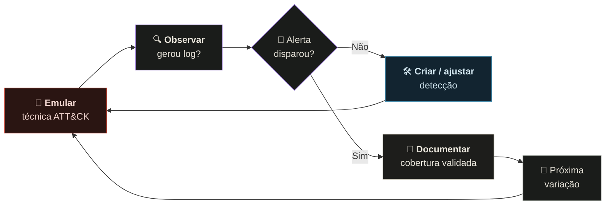
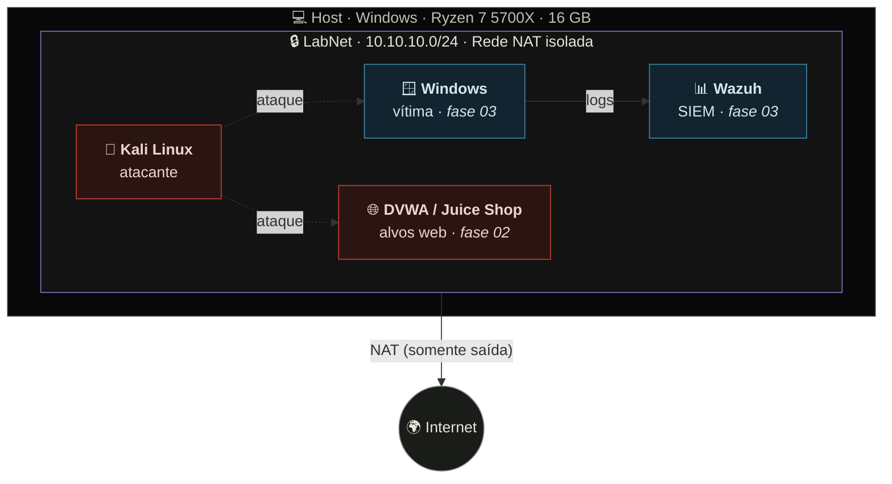

<div align="center">



<br/>

[](#trilha)
[](https://attack.mitre.org/)
[](https://www.kali.org/)
[](LICENSE)

**Laboratório prático e documentado de Purple Team:** executo técnicas reais de adversários em ambiente isolado,
verifico se a defesa enxerga, crio a detecção que faltava e registro cada decisão.

[🧪 Laboratório](00-lab-setup/) ·
[🗺️ Trilha](#trilha) ·
[🔁 Metodologia](#metodologia) ·
[🏗️ Arquitetura](#arquitetura) ·
[👤 Sobre mim](#sobre-mim)

</div>

---

## 🎯 Por que este repositório existe

Um teste de invasão responde *"conseguimos entrar?"*. Ele raramente responde a pergunta que mais importa para a empresa:

> **"Se um atacante real fizesse isso, nós perceberíamos?"**

Este laboratório existe para responder essa pergunta, técnica por técnica. Cada experimento aqui une os dois lados:

| 🔴 Lado ofensivo | 🔵 Lado defensivo | 🟣 Resultado |
|:---|:---|:---|
| Emular uma técnica do MITRE ATT&CK | Verificar logs, telemetria e alertas | Detecção criada, testada e documentada |
| Testar variações do mesmo procedimento | Medir tempo até a detecção | Lacunas de visibilidade mapeadas |
| Documentar o *como* e o *porquê* | Propor *hardening* e mitigação | Relatório técnico e executivo |

---

<a id="metodologia"></a>

## 🔁 Metodologia: o ciclo Purple



**Princípio central:** bloquear *um* procedimento não significa estar protegido contra a *técnica*.
Por isso cada técnica é testada em mais de uma variação antes de ser considerada coberta.

---

<a id="trilha"></a>

## 🗺️ Trilha de evolução

| Fase | Módulo | Competências | Entregas | Status |
|:---:|:---|:---|:---|:---:|
| **00** | [🧪 Laboratório](00-lab-setup/) | Virtualização, redes, segmentação, integridade | Lab isolado e documentado |  |
| **01** | [📡 Reconhecimento](01-recon/) | Nmap, enumeração, OSINT | Write-ups e automação de recon |  |
| **02** | [🌐 Segurança Web](02-web/) | OWASP Top 10, Burp Suite, APIs | Relatórios de pentest web |  |
| **03** | [🔵 Blue Team](03-blue/) | Sysmon, Wazuh (SIEM), análise de logs | SIEM funcional e dashboards |  |
| **04** | [🟣 Purple Team](04-purple/) | Atomic Red Team, regras Sigma | Matriz de cobertura ATT&CK |  |

<details>
<summary><b>📈 Fases avançadas (clique para expandir)</b></summary>
<br/>

| Fase | Módulo | Competências |
|:---:|:---|:---|
| **05** | 🏢 Active Directory | Kerberoasting, Pass-the-Hash, BloodHound e suas detecções |
| **06** | ⚙️ Detection Engineering | Detection-as-Code, CI/CD, Threat Hunting, automação em Python |
| **07** | 🎭 Emulação de Adversários | Planos baseados em grupos reais, Caldera, métricas e relatório executivo |

</details>

---

<a id="arquitetura"></a>

## 🏗️ Arquitetura do laboratório



> As máquinas marcadas com *fase* serão adicionadas conforme a trilha avança. A rede do laboratório
> **não alcança** a rede doméstica: nenhuma VM usa modo *Bridge*. Detalhes e justificativas em [`00-lab-setup`](00-lab-setup/).

---

## 🧰 Stack

<div align="center">

**Ofensivo**<br/>


**Defensivo**<br/>


**Infraestrutura e automação**<br/>


</div>

---

## 📂 Estrutura do repositório

<details>
<summary><b>Ver árvore de diretórios</b></summary>

```text
purple-team-lab/
├── 00-lab-setup/     🧪 Montagem do laboratório e decisões de arquitetura
├── 01-recon/         📡 Reconhecimento e enumeração
├── 02-web/           🌐 Segurança de aplicações web
├── 03-blue/          🔵 Telemetria, SIEM e análise de logs
├── 04-purple/        🟣 Emulação ATT&CK e engenharia de detecção
├── templates/        📝 Modelos padronizados de write-up
└── assets/           🎨 Banners, diagramas e evidências
```

</details>

Todo experimento segue o mesmo [modelo de write-up](templates/WRITEUP_TEMPLATE.md): **objetivo → mapeamento ATT&CK → execução → telemetria → detecção → mitigação → lições aprendidas**.

---

<a id="sobre-mim"></a>

## 👤 Sobre mim

<table>
<tr>
<td width="68%" valign="top">

**João Pedro Lustosa** · Fortaleza, CE 🇧🇷

Coordenador de TI em ambiente industrial e desenvolvedor front-end (React · TypeScript),
pós-graduando em **Segurança da Informação** e em **Direito Digital e Proteção de Dados (LGPD)**.

Minha vantagem é enxergar o sistema inteiro: **como ele é construído** (desenvolvimento),
**como ele roda** (infraestrutura, redes, servidores) e **como precisa ser protegido** (segurança e conformidade).
Este laboratório é onde essas três visões se encontram na prática.

</td>
<td width="32%" valign="top">

**🎯 Áreas de interesse**
- Purple Team e Detection Engineering
- Application Security (AppSec)
- Segurança de ambientes industriais (OT)
- GRC e Proteção de Dados

</td>
</tr>
</table>

<div align="center">

[](https://www.linkedin.com/in/adslustosa)
[](https://github.com/ADSLustosa)

</div>

---

## ⚖️ Aviso ético e legal

> [!WARNING]
> Todo o conteúdo deste repositório foi produzido em **ambiente próprio e isolado** ou em plataformas que
> **autorizam expressamente** os testes (como TryHackMe, HackTheBox e PortSwigger Academy).
> As técnicas aqui documentadas têm finalidade **exclusivamente educacional e defensiva**.
> Utilizá-las contra sistemas sem autorização formal é crime no Brasil (Lei nº 12.737/2012 · art. 154-A do Código Penal).

<div align="center">
<br/>
<sub>🟣 Construído com método, documentado com propósito.</sub>
</div>
